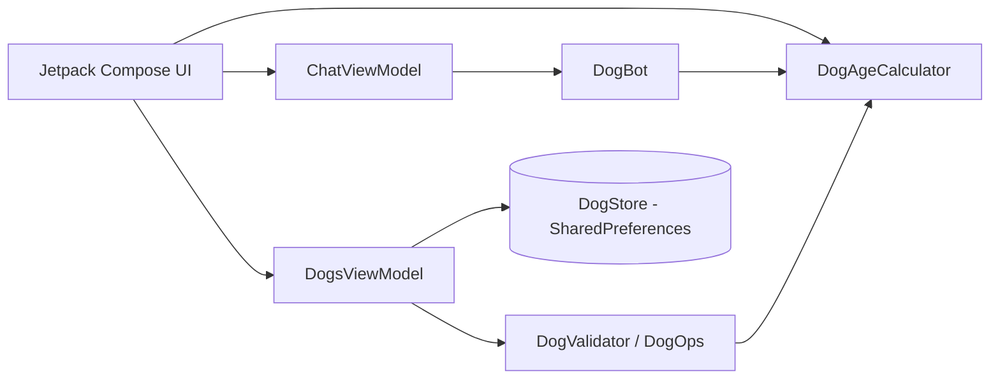

# Arquitectura — Aplicación de la edad del perro

Patrón: UI declarativa (Jetpack Compose) + ViewModel + lógica pura en Kotlin (fácil de probar).

Diagramas completos en `Documentacion/Modelos_Datos/`.
